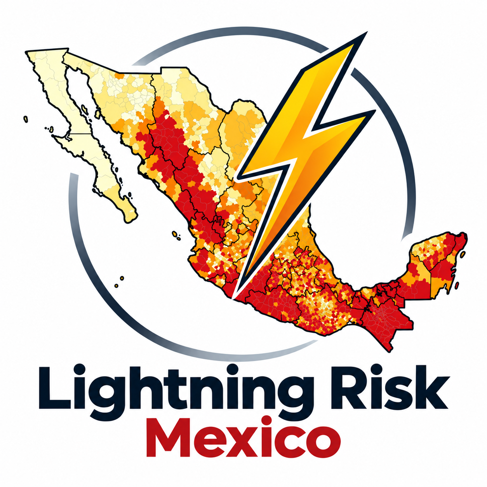
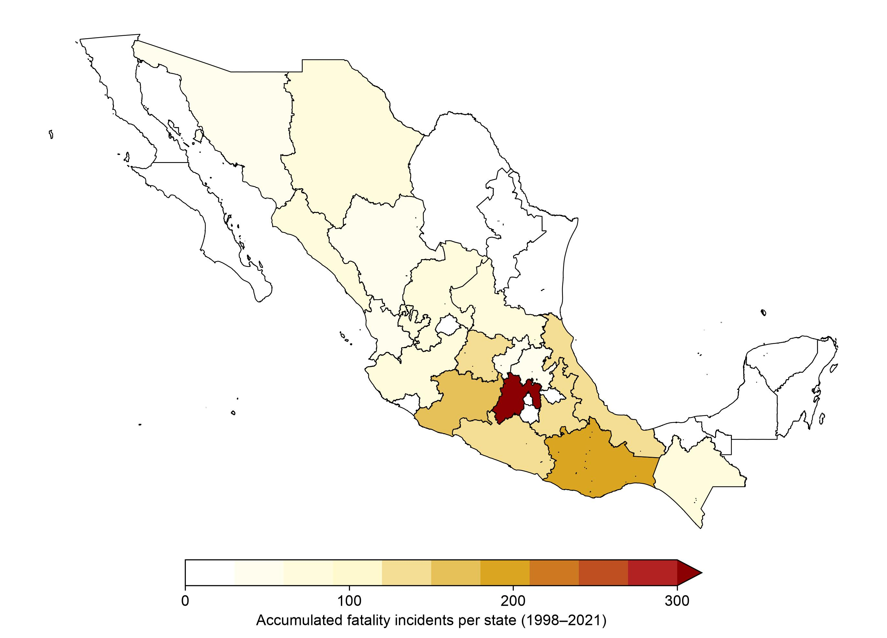
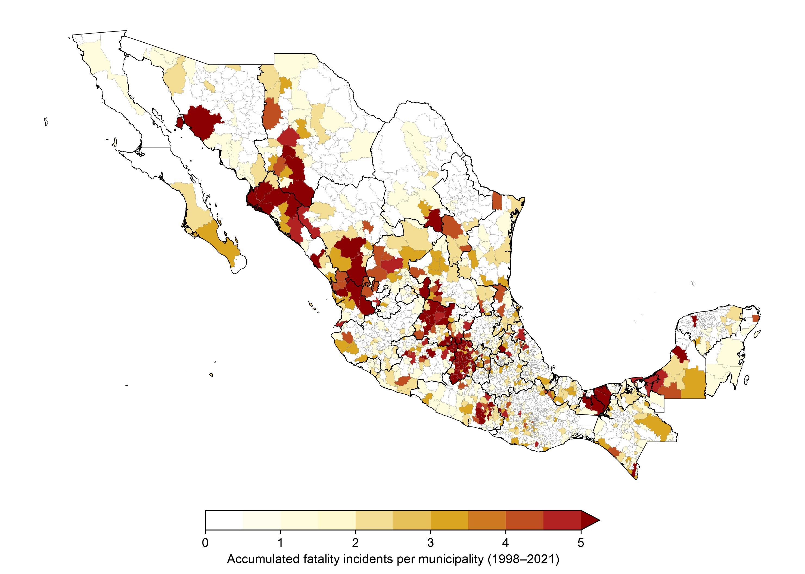
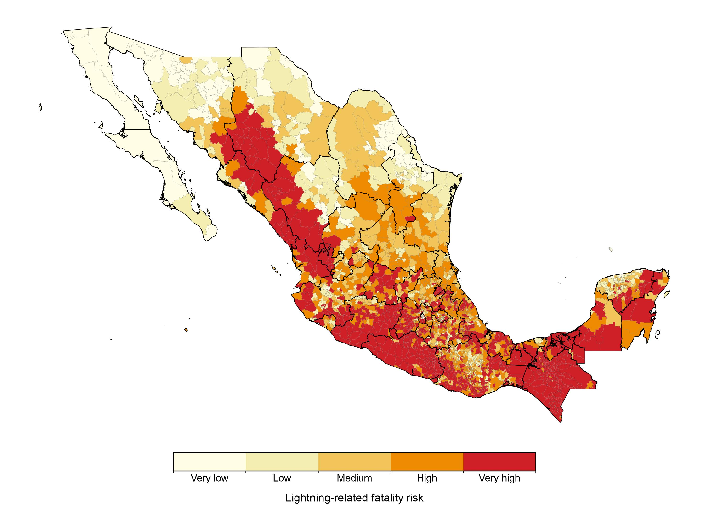

<p align="center">
  
</p>

<h1 align="center">LightningRiskMX</h1>

<p align="center">
  <strong>Mapping Lightning Risk in Mexico: Integrating Natural Hazard and Social Vulnerability</strong><br>

  Maps and ready-to-use geospatial data based on Jaramillo and Dominguez (2024)
</p>

<p align="center">
  <a href="https://doi.org/10.1175/WCAS-D-23-0151.1">Published article and supplementary material</a> ·

  <a href="https://ajaramillomoreno.github.io/projects/lightning-risk-mx/">Research project page</a> ·

  <a href="https://ajaramillomoreno.github.io/projects/lightning-risk-mx/maps/index.html">Interactive atlas</a> ·
  <a href="https://doi.org/10.5281/zenodo.23525980">Zenodo v1.0 dataset</a>
</p>

<p align="center">
  <a href="https://doi.org/10.5281/zenodo.23525979">
    
  </a>
</p>

## Overview

**LightningRiskMX** provides scientific maps and downloadable geospatial representations of the results published in *Mapping Lightning Risk in Mexico: Integrating Natural Hazard and Social Vulnerability* (Jaramillo and Dominguez, 2024), in *Weather, Climate, and Society*.

The published study investigates **lightning-related fatality risk at the municipal level in Mexico** by combining lightning hazard with social vulnerability. Its **original municipality-level results are available as tabular data, without polygon geometries, in the supplementary material of the article**.

The purpose of this repository is different from that of the article: **to make those already-published results easier to download, visualize, and use in Geographic Information Systems (GIS)**. For this purpose, the research data were associated with municipal boundary polygons distributed through the **CONABIO Geoportal** and exported as simplified GeoJSON files. This spatial representation was prepared for **LightningRiskMX**; it should not be interpreted as an additional component of the original article's scientific methodology.

For scientific interpretation, consult the [published article](https://doi.org/10.1175/WCAS-D-23-0151.1). To explore the maps online, visit the [interactive atlas](https://ajaramillomoreno.github.io/projects/lightning-risk-mx/maps/index.html). The [v1.0 geospatial dataset is permanently archived on Zenodo](https://doi.org/10.5281/zenodo.23525980).

## Main findings of the published study

- **2,573 lightning-related deaths** were recorded in Mexican official mortality statistics during **1998–2021**.

- **Deaths and fatality incidents are different quantities.** A fatality incident is counted for a municipality and day with at least one reported lightning-related death; one incident can involve multiple deaths.

- **Fatality incidents are unevenly distributed geographically.** The State of Mexico recorded the largest number of incidents, and the municipal distribution reveals important spatial contrasts.

- **Social vulnerability matters.** Lightning fatalities disproportionately affected rural communities and people engaged in outdoor activities. Men accounted for **81.4%** of recorded deaths.

- **82.1% of reported fatality incidents occurred in municipalities classified as high or very high risk** in the published assessment (**25.6%** and **56.5%**, respectively).

- **The national lightning fatality rate decreased over the longer historical record**, from approximately **5.6 deaths per million people** in the early 1980s to **0.3 deaths per million** in 2021.

These values are findings of **Jaramillo and Dominguez (2024)**, not new analyses carried out for this repository. The article is the authoritative source for the results and their interpretation.

## Scientific maps

### Lightning fatality incidents by state — Figure 2a

<p align="center">
  
</p>

*Accumulated lightning-related fatality incidents by state, 1998–2021. State totals were obtained by aggregating municipal incident counts for the geospatial products in this repository.*

### Lightning fatality incidents by municipality — Figure 2b

<p align="center">
  
</p>

*Accumulated lightning-related fatality incidents by municipality, 1998–2021. The municipal representation reveals variations that are not evident in state-level totals.*

### Municipal lightning fatality risk — Figure 6

<p align="center">
  
</p>

*Municipal lightning fatality risk classification, combining physical lightning hazard and social vulnerability. Categories range from very low to very high.*

These maps illustrate the results discussed in **Figures 2a, 2b, and 6** of the paper. Refer to the original article for its published figures, methods, and scientific context.

## Downloadable geospatial data

The [`data/`](data/) directory contains **three GeoJSON products** derived from the original supplementary tables and prepared for use in GIS software and geospatial applications.

| File | Spatial unit | Main attributes | Content |
| --- | --- | --- | --- |
| [`municipal_lightning_incidents.geojson`](data/municipal_lightning_incidents.geojson) | Municipality | `ENTIDAD`, `MUN`, `NOM_ENT`, `NOM_MUN`, `Muertes_e` | Accumulated fatal lightning incidents, 1998–2021 |
| [`state_lightning_incidents.geojson`](data/state_lightning_incidents.geojson) | State | `ENTIDAD`, `NOM_ENT`, `Muertes_e` | Municipal incident counts aggregated to states |
| [`municipal_lightning_risk.geojson`](data/municipal_lightning_risk.geojson) | Municipality | `ENTIDAD`, `MUN`, `NOM_ENT`, `NOM_MUN`, `GN_Risk` | Municipal lightning fatality risk categories |

All three files contain polygon geometries with **longitude/latitude coordinates in WGS84**, following the coordinate order used by GeoJSON.

### Variable definitions

| Variable | Description |
| --- | --- |
| `ENTIDAD` | State identifier |
| `MUN` | Municipality identifier |
| `NOM_ENT` | State name |
| `NOM_MUN` | Municipality name |
| `Muertes_e` | Accumulated **fatal lightning incidents**, not the number of individual deaths |
| `GN_Risk` | Municipal risk class: `0` = very low; `1` = low; `2` = medium; `3` = high; `4` = very high |
| `geometry` | Simplified municipal or state polygon |

**Important:** Although the inherited field name `Muertes_e` refers linguistically to deaths, the values provided in these GeoJSON products represent **fatality incidents**. Do not equate them with the **2,573 individual deaths** reported in the article.

### How to use the files

The GeoJSON files can be opened directly in QGIS or other GIS applications. They can also be read in Python using GeoPandas:

```python

import geopandas as gpd

incidents = gpd.read_file("data/municipal_lightning_incidents.geojson")

risk = gpd.read_file("data/municipal_lightning_risk.geojson")

print(incidents.head())

print(risk.head())

```

### Geometry limitations

These are **generalized cartographic representations**, not authoritative legal, administrative, or cadastral boundaries. Municipal polygons were simplified and coordinate precision was reduced to facilitate distribution and visualization. State polygons were produced by aggregating the municipal geometries.

The resulting files should **not** be used for precise measurements of area, distance, or administrative boundaries. Small discrepancies may remain along shared polygon edges.

## Archived dataset and DOI

**LightningRiskMX v1.0** has been archived on Zenodo as a citable, versioned snapshot of the repository, including the three GeoJSON products, scientific figures, and documentation.

- **Version-specific DOI (v1.0):** [10.5281/zenodo.23525980](https://doi.org/10.5281/zenodo.23525980). Use this DOI to identify the exact v1.0 archive.
- **DOI for all versions:** [10.5281/zenodo.23525979](https://doi.org/10.5281/zenodo.23525979). Use this DOI to refer to the LightningRiskMX record across releases.
- **GitHub release:** [LightningRiskMX v1.0](https://github.com/ajaramillomoreno/LightningRiskMX/releases/tag/v1.0).

The Zenodo deposit is a snapshot of the files at the time of release. Subsequent changes to the GitHub `main` branch do not alter the archived v1.0 dataset. **The DOI assigned to LightningRiskMX is distinct from the DOI of the original research article.** Scientific results should continue to be attributed to Jaramillo and Dominguez (2024).

## Data provenance and cartographic attribution

It is important to distinguish the **source of the scientific results** from the **source of the geometry used to distribute them spatially**.

### Scientific results and supplementary data

The fatality incident counts and municipal risk classifications come from **Jaramillo and Dominguez (2024)**. The original supplementary material accompanying the paper provides the municipality-level results **as tables without polygon geometries**, including geographic identifiers that make spatial joins possible.

**The supplementary material and the article are the primary scientific sources.** LightningRiskMX does not claim these data as new research results and does not replace the original supplementary files.

### Municipal cartography used in LightningRiskMX

To create the downloadable GeoJSON files **for this repository**, the published municipal results were joined to polygons from the **2020 municipal administrative division of Mexico**, accessed through the **Geoportal of the Comisión Nacional para el Conocimiento y Uso de la Biodiversidad (CONABIO)**.

The cartographic product is attributed to the **Instituto Nacional de Estadística y Geografía (INEGI)** and is listed in CONABIO's documentation as the 2020 municipal division (`mun20gw`).

**Cartographic reference:** INEGI (2021), *División política municipal, 2020*. Distributed through the [CONABIO Geoportal](https://geoportal.conabio.gob.mx/#!l=mun20gw:1@m=mixto). See also the [CONABIO SNIB data dictionary](https://www.snib.mx/diccionarioSNIB/).

The processing performed for **LightningRiskMX** consisted of joining the article's municipality-level tabular results to the polygons, aggregating municipal incident counts by state, simplifying the geometries, and exporting the results to GeoJSON.

**This cartographic processing describes the products in this repository, not the methodology used to develop the original article.** CONABIO and INEGI are credited for the geographic representation, not as authors of the lightning-risk research results.

### Sources used in the original research

The article documents the scientific datasets and methods used to construct the risk assessment, including:

- Official lightning-related mortality records from the Mexican health authorities, covering **1998–2021**.

- The **WWLLN Global Lightning Climatology (WGLC)** for the physical lightning hazard.

- **CONAPO's 2020 marginalization indicators** for the social vulnerability component, based on census information produced by INEGI.

**CONAPO** (Consejo Nacional de Población) and **CONABIO** (Comisión Nacional para el Conocimiento y Uso de la Biodiversidad) are different institutions and have distinct roles in the material described above.

## Methodological summary of the article

The published study estimates lightning-related fatality risk by combining:

1. **Lightning hazard:** Mean annual frequency of days with lightning, using WGLC data for **2010–2021**.

2. **Social vulnerability:** The normalized **2020 marginalization index** at the locality level.

The locality-level risk combines normalized hazard and vulnerability. The study classifies risk into five ordinal categories using the **Dalenius–Hodges method**. To represent risk at the municipal level, the highest locality risk category within each municipality is used. The risk classification is then evaluated against reported fatality incidents for **1998–2021**.

The original study focuses on deaths rather than nonfatal injuries and is subject to the limitations of mortality reporting and lightning observations. **Consult the article for the complete methodology and interpretation before using these data for risk assessment or policy decisions.**

## Interactive exploration

The [LightningRiskMX Interactive Atlas](https://ajaramillomoreno.github.io/projects/lightning-risk-mx/maps/index.html) displays three complementary maps:

1. Fatal lightning incidents by municipality.

2. Fatal lightning incidents by state.

3. Municipal lightning fatality risk.

The atlas supports geographical exploration through search, filters, and location-specific information. It is hosted on the author's [academic website](https://ajaramillomoreno.github.io/projects/lightning-risk-mx/). This GitHub repository distributes the maps and ready-to-use geographic datasets.

## Citation and reuse

**If you use the incident data, risk classifications, or maps from LightningRiskMX, please cite the original scientific article:**

> Jaramillo, A., and C. Dominguez, 2024: Mapping Lightning Risk in Mexico: Integrating Natural Hazard and Social Vulnerability. *Weather, Climate, and Society*, **16**(3), 563–574. https://doi.org/10.1175/WCAS-D-23-0151.1

The original article and its supplementary material remain the authoritative sources for the scientific results. **If you use the geospatial files from this repository, please cite the original article and, additionally, the specific version of the archived dataset:**

> Jaramillo, A., & Dominguez, C. (2026). *LightningRiskMX v1.0: Geospatial Representation of Lightning Fatality Incidents and Risk in Mexico* (Version v1.0) [Dataset]. Zenodo. https://doi.org/10.5281/zenodo.23525980

For citations that refer to the evolving dataset across versions, use the [all-versions DOI](https://doi.org/10.5281/zenodo.23525979). The original tabular datasets can be obtained from the article's supplementary material.

**Cartographic attribution:** Acknowledge **INEGI** as the cartographic source of the 2020 municipal boundaries and **CONABIO** as the provider through which the corresponding geographic layer was accessed. The GeoJSON geometries have been processed and simplified for this repository.

**Reuse conditions:** Scientific citation and cartographic attribution are separate obligations. Any redistribution or reuse of the geographic boundaries must comply with the applicable terms of the underlying cartographic product and its distributor. This repository does not claim to grant additional rights over third-party boundary data. No blanket open-data license for those geometries is implied by their inclusion here.

## Authors

**Alejandro Jaramillo** and **Christian Dominguez**

Instituto de Ciencias de la Atmósfera y Cambio Climático (ICAyCC), Universidad Nacional Autónoma de México (UNAM)

---

*LightningRiskMX provides geographic representations of previously published scientific results. The research article and its supplementary material remain the authoritative sources for the data, methods, and interpretation.*
